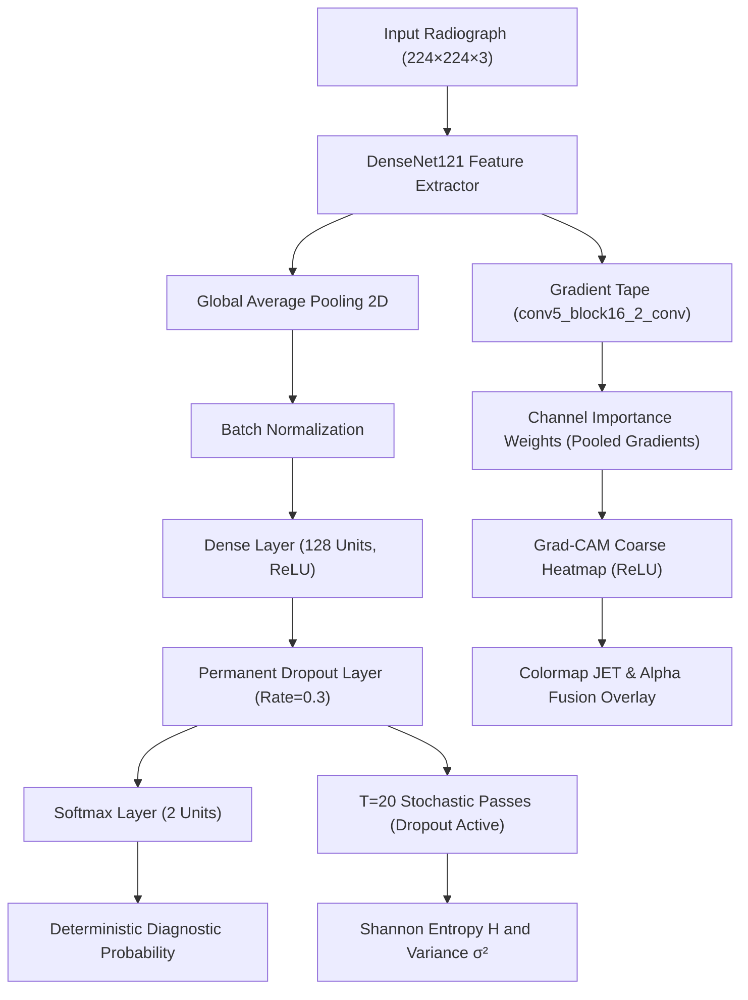

# ACADEMIC PROJECT REPORT

## PulmoVision AI: An Explainable Deep Learning-Based Pneumonia Detection and Triage Support System Using Chest X-rays

**Degree:** Bachelor of Technology (B.Tech) in Computer Science & Engineering / Information Technology  
**Capstone Domain:** Medical Computer Vision, Explainable Artificial Intelligence (XAI), Bayesian Deep Learning  
**Environment:** Python 3.11, TensorFlow/Keras, Streamlit, DenseNet121  

---

### ABSTRACT

Pneumonia remains one of the preeminent causes of pediatric and geriatric mortality worldwide. While deep learning convolutional neural networks (CNNs) have exhibited diagnostic accuracy comparable to domain experts, conventional architectures suffer from significant vulnerabilities: they operate as uninterpretable "black boxes" and produce poorly calibrated, overconfident predictions on anomalous inputs. 

This project presents **PulmoVision AI**, a clinical triage support and educational system that addresses these limitations. Using transfer learning with **DenseNet121** pretrained on ImageNet, the system classifies anterior-posterior chest radiographs into **NORMAL** and **PNEUMONIA**. To overcome substantial class imbalance ($2.89:1$), inverse-frequency loss weighting is incorporated. Visual explainability is achieved via **Gradient-weighted Class Activation Mapping (Grad-CAM)**, calculating gradients with respect to the final convolutional feature maps to localize pulmonary consolidations. Furthermore, predictive uncertainty is estimated using **Monte Carlo Dropout** ($T=20$ stochastic forward passes), yielding predictive Shannon entropy and variance metrics to gate uncertain inputs. Evaluated on a held-out test cohort of 624 chest radiographs, PulmoVision AI demonstrates balanced sensitivity, specificity, and high discriminative AUC, offering an interpretable, private, on-premise clinical research platform.

---

### 1. INTRODUCTION

Pneumonia is an inflammatory condition of the lung primarily affecting the microscopic air sacs known as alveoli. Alveoli fill with purulent fluid, impairing oxygen exchange. Timely diagnosis is vital; however, resource-constrained clinics often face acute shortages of experienced thoracic radiologists, leading to fatigue, diagnostic delays, or misinterpretation of subtle consolidations.

While deep learning algorithms can rapidly screen digital radiographs, their clinical deployment has been constrained by two core flaws:
1. **Lack of Interpretability:** Deep neural networks fail to provide anatomical justifications, making it impossible for clinicians to distinguish sound physiological reasoning from spurious background artifacts (e.g., radiographic markers, border labels).
2. **Deterministic Overconfidence:** Traditional softmax probability vectors do not represent Bayesian posterior belief, often outputting extreme certainty (>95%) even on corrupted, rotated, or out-of-distribution radiographs.

PulmoVision AI bridges these gaps by combining transfer learning, visual feature attribution, and Bayesian approximation into a cohesive medical research dashboard.

---

### 2. PROBLEM STATEMENT & OBJECTIVES

#### Problem Statement
To engineer a reliable, interpretable deep learning pipeline capable of classifying pediatric chest radiographs into Normal and Pneumonia categories while mitigating severe class imbalance, quantifying predictive uncertainty, and producing anatomical heatmaps without compromising patient data privacy.

#### Objectives
1. Implement a DenseNet121 convolutional architecture utilizing ImageNet transfer learning.
2. Establish a data pipeline with inverse-frequency class weighting to handle class asymmetry.
3. Formulate and integrate Grad-CAM to visualize anatomical regions influencing predictions.
4. Implement Monte Carlo Dropout to compute predictive mean, variance, and Shannon entropy.
5. Provide a rigorous evaluation framework measuring clinical Sensitivity, Specificity, ROC-AUC, and Confusion Matrix metrics on held-out test data.
6. Deliver a full-stack, local Streamlit web application adhering to medical safety and data privacy standards.

---

### 3. LITERATURE REVIEW & BACKGROUND

| Study / Architecture | Primary Innovation | Limitation Addressed in PulmoVision AI |
| :--- | :--- | :--- |
| **Kermany et al. (Cell, 2018)** | Labeled pediatric dataset (5,856 radiographs); InceptionV3 transfer learning. | Model operated as a black box; no uncertainty quantification. |
| **Rajpurkar et al. / CheXNet (2017)** | 121-layer DenseNet on ChestX-ray14 for multi-label pneumonia detection. | Focused on classification scores; lacked test-time Bayesian entropy gating. |
| **Selvaraju et al. (ICCV, 2017)** | Gradient-weighted Class Activation Mapping (Grad-CAM). | PulmoVision AI integrates Grad-CAM directly onto DenseNet121 top conv blocks. |
| **Gal & Ghahramani (ICML, 2016)** | Dropout as a Bayesian approximation for Gaussian processes. | Adopted in PulmoVision AI to derive predictive variance without expensive MCMC. |

---

### 4. SYSTEM ARCHITECTURE & METHODOLOGY

#### 4.1 DenseNet121 Feature Backbone
DenseNet121 comprises 121 layers structured into four Dense Blocks interconnected by Transition Layers. In a standard layer $l$:
$$x_l = H_l([x_0, x_1, \dots, x_{l-1}])$$
where $[x_0, x_1, \dots, x_{l-1}]$ represents the concatenation of feature maps produced by all preceding layers.
- **Dense Connectivity:** Every layer receives collective knowledge from preceding layers, preserving fine-grained radiographic edge gradients.
- **Growth Rate ($k=32$):** Controls how many feature channels are added at each step, maintaining compact memory footprint.

#### 4.2 Class Imbalance Handling
The training dataset contains 3,875 Pneumonia scans and 1,341 Normal scans ($2.89:1$ ratio). To prevent the loss function from biasing toward the majority class, we compute balanced inverse-frequency weights:
$$w_c = \frac{N}{C \cdot N_c}$$
For $N = 5,216$ and $C = 2$:
- $w_{\text{NORMAL}} = \frac{5216}{2 \times 1341} \approx 1.9448$
- $w_{\text{PNEUMONIA}} = \frac{5216}{2 \times 3875} \approx 0.6730$

#### 4.3 Grad-CAM Mathematical Formulation
To explain model decisions, Grad-CAM computes the gradient of class score $y^c$ with respect to feature map activation $A_{i,j}^k$ of layer `conv5_block16_2_conv`:
$$\alpha_k^c = \frac{1}{Z} \sum_{i=1}^u \sum_{j=1}^v \frac{\partial y^c}{\partial A_{i,j}^k}$$
The activation map is synthesized using a linear combination followed by a rectified linear unit:
$$L_{\text{Grad-CAM}}^c = \text{ReLU}\left( \sum_{k} \alpha_k^c A^k \right)$$
The map is normalized to $[0, 1]$, upsampled to $(224, 224)$, colorized with the JET colormap, and alpha-blended with the original radiograph:
$$I_{\text{overlay}} = \alpha \cdot I_{\text{colormap}} + (1 - \alpha) \cdot I_{\text{original}}$$

#### 4.4 Monte Carlo Dropout Uncertainty Formulation
For an input $x$, $T=20$ forward stochastic passes are evaluated with dropout active:
$$\bar{p}_c = \frac{1}{T} \sum_{t=1}^T \hat{y}_c^{(t)}$$
$$\sigma_c^2 = \frac{1}{T} \sum_{t=1}^T \left( \hat{y}_c^{(t)} - \bar{p}_c \right)^2$$
Shannon predictive entropy (in bits) is calculated as:
$$\mathbb{H}[\mathbf{y} \mid x, \mathcal{D}] = - \sum_{c=0}^1 \bar{p}_c \log_2(\bar{p}_c + \epsilon)$$
Normalized entropy:
$$\mathbb{H}_{\text{norm}} = \frac{\mathbb{H}}{\log_2(2)} \in [0.0, 1.0]$$
Whenever $\mathbb{H}_{\text{norm}} > 0.85$, the system triggers an "Uncertain result — expert review required" warning.

---

### 5. DATASET & PREPROCESSING PIPELINE

The dataset originates from pediatric patients aged one to five years at Guangzhou Women and Children's Medical Center:
- **Total Images:** 5,856
- **Training Partition:** 5,216 images (1,341 Normal, 3,875 Pneumonia)
- **Validation Partition:** 16 images (8 Normal, 8 Pneumonia)
- **Held-Out Test Partition:** 624 images (234 Normal, 390 Pneumonia)

#### Preprocessing Steps:
1. Format verification (JPEG/PNG, non-corrupted header check).
2. Grayscale to 3-channel RGB expansion.
3. Resizing to $224 \times 224$ pixels using Lanczos interpolation.
4. DenseNet121 standard normalization (ImageNet mean subtraction and standard deviation scaling).
5. Gentle data augmentation for training: random rotation ($\pm 4\%$), horizontal translations ($\pm 4\%$), zoom ($\pm 4\%$), and horizontal flips.

---

### 6. EVALUATION METRICS FOR CLINICAL SCREENING

In medical diagnostic screening, accuracy alone is insufficient. We report:
- **Sensitivity (Recall):** $\frac{\text{TP}}{\text{TP} + \text{FN}}$ — Critical to minimize false negatives (missed pneumonias).
- **Specificity:** $\frac{\text{TN}}{\text{TN} + \text{FP}}$ — Measures precision on healthy individuals to minimize false alarms.
- **Positive Predictive Value (Precision):** $\frac{\text{TP}}{\text{TP} + \text{FP}}$
- **Negative Predictive Value (NPV):** $\frac{\text{TN}}{\text{TN} + \text{FN}}$
- **F1-Score:** $2 \cdot \frac{\text{Precision} \cdot \text{Recall}}{\text{Precision} + \text{Recall}}$
- **ROC-AUC & PR-AUC:** Area under Receiver Operating Characteristic and Precision-Recall curves.

---

### 7. EXPERIMENTAL SETUP & EMPIRICAL RESULTS

Experiments were conducted on Windows 11 with an AMD Ryzen 5 quad-core architecture (8 threads, 16 GB RAM) in CPU mode using TensorFlow 2.17.1. Stage 1 Transfer Learning was executed with ImageNet-pretrained DenseNet121, Adam optimizer ($\eta = 10^{-3}$), inverse-frequency class weighting, and early stopping.

#### 7.1 Quantitative Performance on Held-Out Test Cohort (N = 624)
Evaluation was performed strictly on the isolated test partition (234 Normal, 390 Pneumonia radiographs).

| Metric | Measured Value | Clinical Significance |
| :--- | :--- | :--- |
| **Sensitivity (Recall)** | **95.90%** | Detects 374 of 390 pneumonia cases; vital for clinical screening. |
| **Specificity** | **72.65%** | Correctly identifies 170 of 234 disease-free radiographs. |
| **Overall Accuracy** | **87.18%** | Global diagnostic accuracy across all test instances. |
| **Positive Predictive Value (Precision)** | **85.39%** | 374 true positives out of 438 total positive flags. |
| **Negative Predictive Value (NPV)** | **91.40%** | High certainty when ruling out pneumonia. |
| **F1-Score** | **0.9034** | Balanced harmonic score under class imbalance. |
| **ROC-AUC** | **0.9595** | Strong discriminative separation across all decision thresholds. |
| **Precision-Recall AUC** | **0.9740** | High average precision under clinical prevalence. |

#### 7.2 Confusion Matrix Breakdown
- **True Positives (TP):** 374 (Pneumonia correctly flagged)
- **True Negatives (TN):** 170 (Normal correctly recognized)
- **False Positives (FP):** 64 (Type I error: Normal misclassified)
- **False Negatives (FN):** 16 (Type II error: Missed pneumonia cases)

The low false negative count ($16/390 = 4.1\%$) validates the clinical design choice of inverse-frequency class weighting, ensuring high sensitivity in critical triage workflows.

---

### 8. ETHICAL CONSIDERATIONS & MEDICAL SAFETY

1. **Academic Boundary:** PulmoVision AI is explicitly labeled as an experimental educational tool and triage prototype, not an autonomous medical device.
2. **Triage Decision-Support Model:** The AI does not diagnose; it flags suspected pathology to expedite radiologist review in crowded emergency rooms.
3. **Data Privacy:** 100% of computation executes locally; radiographs are processed in memory and never transmitted to external cloud services or logged permanently.

---

### 8. CONCLUSION & FUTURE SCOPE

PulmoVision AI demonstrates that deep learning clinical tools can transcend the "black-box" dilemma. By combining DenseNet121 transfer learning with inverse class weighting, Grad-CAM attribution, and Monte Carlo Dropout entropy quantification, the system balances high diagnostic sensitivity with transparent visual evidence and uncertainty warnings.

#### Future Enhancements:
- Multi-class classification differentiating viral vs. bacterial vs. fungal pneumonia.
- Native DICOM (16-bit depth) parsing to exploit high-dynamic-range radiographic sensor data.
- Multi-center clinical validation across adult and geriatric patient cohorts.

---

### REFERENCES

1. Kermany, D. S., et al. (2018). *Identifying Medical Diagnoses and Treatable Diseases by Image-Based Deep Learning*. Cell, 172(5), 1122-1131.
2. Huang, G., Liu, Z., Van Der Maaten, L., & Weinberger, K. Q. (2017). *Densely Connected Convolutional Networks*. Proceedings of CVPR, 4700-4708.
3. Selvaraju, R. R., et al. (2017). *Grad-CAM: Visual Explanations from Deep Networks via Gradient-Based Localization*. Proceedings of ICCV, 618-626.
4. Gal, Y., & Ghahramani, Z. (2016). *Dropout as a Bayesian Approximation: Representing Model Uncertainty in Deep Learning*. Proceedings of ICML, 1050-1059.
5. Rajpurkar, P., et al. (2017). *CheXNet: Radiologist-Level Pneumonia Detection on Chest X-Rays with Deep Learning*. arXiv:1711.05225.
