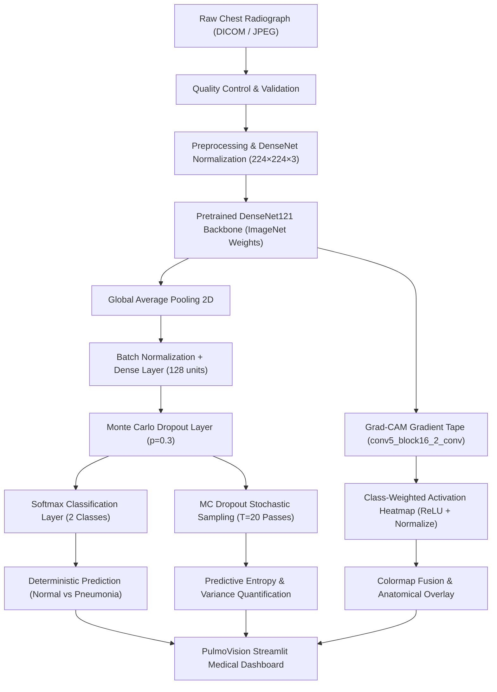

# PulmoVision AI: Explainable Chest X-ray Analysis for Pneumonia Triage Research

[](https://www.python.org/)
[](https://tensorflow.org/)
[](https://keras.io/api/applications/densenet/)
[](https://streamlit.io/)
[]()

> **Final-Year B.Tech Computer Science & Engineering Capstone Project**  
> An explainable, Bayesian-approximated deep learning triage support system for detecting pediatric and adult pneumonia on chest radiographs using transfer learning, Grad-CAM visual heatmaps, and Monte Carlo Dropout uncertainty estimation.

---

## 1. Project Introduction

Pneumonia is an acute respiratory infection affecting the pulmonary alveoli, representing one of the leading causes of infectious disease mortality globally, particularly among children under five years of age and elderly populations. Accurate, rapid interpretation of anterior-posterior (AP) chest radiographs (CXRs) is essential for effective clinical triage. However, conventional deep learning models function as opaque "black boxes" that produce overconfident predictions without localized visual rationales or uncertainty metrics.

**PulmoVision AI** addresses these fundamental limitations by bridging state-of-the-art Computer Vision with Explainable Artificial Intelligence (XAI) and Bayesian deep learning. It classifies chest radiographs into **NORMAL** and **PNEUMONIA** categories while delivering:
1. **Calibrated Predictive Confidence**
2. **Information-Theoretic Uncertainty (Monte Carlo Dropout)**
3. **Anatomical Visual Explanations (Grad-CAM Activation Heatmaps)**
4. **Clinical Evaluation Metrics (Sensitivity, Specificity, ROC-AUC)**
5. **Interactive Medical Research Dashboard (Streamlit)**

---

## 2. Problem Statement

Manual diagnosis of pneumonia from radiographs presents multiple challenges:
- High inter-observer variability among clinicians.
- Acute shortages of specialized thoracic radiologists in resource-constrained regions.
- False negatives leading to delayed antibiotic or oxygen intervention.
- Black-box deep learning models that risk catastrophic misdiagnoses on out-of-distribution or corrupted radiographs.

---

## 3. Project Objectives

- **Transfer Learning with DenseNet121:** Exploit dense feature connectivity pretrained on ImageNet to learn subtle radiographic features (parenchymal consolidation and opacification) without large medical training sets.
- **Class Imbalance Mitigation:** Implement inverse-frequency class loss weighting to offset severe training cohort asymmetry (2.89:1 ratio).
- **Explainable AI (Grad-CAM):** Calculate gradients of predicted class activations with respect to final convolutional feature maps, visually pinpointing suspicious lung zones.
- **Uncertainty Quantification:** Implement test-time Monte Carlo Dropout sampling ($T=20$ forward passes) to estimate predictive Shannon entropy and variance, establishing a reliable "Uncertain result — expert review required" safety gate.
- **Academic Rigor & Privacy:** Deliver a complete, modular, locally deployable solution with zero dependencies on third-party cloud APIs, ensuring zero patient radiograph leakage.

---

## 4. Key Features

- **End-to-End Inference Pipeline:** Instant classification of uploaded radiographs (.jpg, .jpeg, .png).
- **Dual Visual Explanation:** Displays both high-resolution JET colormap heatmaps and alpha-blended anatomical overlays with one-click PNG downloads.
- **Bayesian Epistemic Uncertainty:** Reports predictive entropy (bits), normalized entropy ($[0.0, 1.0]$), and class-specific stochastic standard deviations.
- **Interactive Dataset Explorer:** Real-time cohort audits, split distributions, imbalance charts, and sample radiograph galleries.
- **Training Studio:** Custom hyperparameter controls (batch size, learning rate, Stage 1 epochs, Stage 2 fine-tuning) with live convergence curves.
- **Held-Out Clinical Evaluation:** Reports true clinical screening indicators including **Sensitivity / Recall**, **Specificity**, **F1-Score**, **ROC-AUC**, and interactive confusion matrix breakdowns.

---

## 5. System Architecture



---

## 6. Technology Stack

- **Core Language:** Python 3.11.9
- **Deep Learning Framework:** TensorFlow 2.17.1, Keras 3.15
- **Pretrained Architecture:** DenseNet121 (ImageNet weights)
- **Explainability:** Grad-CAM (Selvaraju et al., 2017)
- **Uncertainty Engine:** Monte Carlo Dropout (Gal & Ghahramani, 2016)
- **Web Application:** Streamlit 1.60.0
- **Image Processing:** OpenCV Headless 4.11, Pillow 12.3
- **Data & Evaluation:** NumPy 1.26, Pandas 3.0, Scikit-learn 1.9, Matplotlib 3.11, Seaborn 0.13, Plotly 7.1
- **Testing:** Pytest 9.1

---

## 7. Dataset Structure Discovered

The workspace dataset was verified from `archive.zip` and structured canonically into `data/chest_xray/`:

```
data/chest_xray/
├── train/
│   ├── NORMAL/       (1,341 images - 25.7%)
│   └── PNEUMONIA/    (3,875 images - 74.3%)  [Total: 5,216 images]
├── test/
│   ├── NORMAL/       (234 images)
│   └── PNEUMONIA/    (390 images)            [Total: 624 images]
└── val/
    ├── NORMAL/       (8 images)
    └── PNEUMONIA/    (8 images)              [Total: 16 images]
```

- **Grand Total:** 5,856 radiographs
- **Class Imbalance:** $2.89 : 1$ (Pneumonia to Normal in training set)
- **Integrity Audit:** 0 corrupted or unreadable images

---

## 8. Installation & Setup (Windows Guide)

### Prerequisites
- Windows 10 or 11 (64-bit)
- Python 3.10 or 3.11 installed
- PowerShell 5.1 or PowerShell Core 7+

### Step 1: Clone or Navigate to Project Directory
```powershell
cd c:\Users\Sumedha\Desktop\PulmoVision-AI
```

### Step 2: Create Python Virtual Environment
```powershell
python -m venv .venv
```

### Step 3: Activate Virtual Environment
```powershell
.\.venv\Scripts\Activate.ps1
```
*(If PowerShell restricts script execution, run: `Set-ExecutionPolicy -Scope Process -ExecutionPolicy Bypass`)*

### Step 4: Upgrade Pip & Install Dependencies
```powershell
python -m pip install --upgrade pip
pip install -r requirements.txt
```

---

## 9. Operating Instructions

### 1. Inspect Dataset
Scan the cohort, check image integrity, and verify class distribution:
```powershell
.\.venv\Scripts\python.exe scripts/inspect_dataset.py --data_dir data/chest_xray
```

### 2. Run Automated Test Suite
Execute the unit tests verifying model layers, Grad-CAM, and Monte Carlo Dropout:
```powershell
.\.venv\Scripts\pytest.exe
```

### 3. Train the Model
Launch Stage 1 Transfer Learning (and optional Stage 2 Fine-Tuning):
```powershell
# Standard 5-epoch transfer learning training (Recommended for CPU)
.\.venv\Scripts\python.exe scripts/train_model.py --data_dir data/chest_xray --epochs 5 --batch_size 16

# Optional fine-tuning with 3 additional epochs
.\.venv\Scripts\python.exe scripts/train_model.py --data_dir data/chest_xray --epochs 5 --fine_tune_epochs 3 --fine_tune --batch_size 16
```

### 4. Evaluate Held-Out Test Set
Compute clinical metrics, confusion matrix, ROC curve, and classification report on the 624 test images:
```powershell
.\.venv\Scripts\python.exe scripts/evaluate_model.py --data_dir data/chest_xray
```

### 5. Launch the Web Application
Start the multi-page Streamlit medical research interface:
```powershell
.\.venv\Scripts\streamlit.exe run app.py
```
Open your browser at `http://localhost:8501`.

---

## 10. Project Directory Layout

```
PulmoVision-AI/
├── app.py                      # Main entrypoint and Home Dashboard
├── config.py                   # Global system constants, paths, hyperparameters
├── requirements.txt            # Python dependencies
├── pytest.ini                  # Pytest configuration
├── README.md                   # Full engineering and operational documentation
├── PROJECT_REPORT.md           # Formal academic project report
├── viva_questions.md           # Comprehensive viva examination Q&A (30+ questions)
├── .gitignore                  # Git ignore rules
│
├── pages/                      # Multi-Page Streamlit Frontend
│   ├── 1_Xray_Analysis.py      # Radiograph inference, Grad-CAM, MC Dropout
│   ├── 2_Dataset_Explorer.py   # Cohort distribution, imbalance, sample gallery
│   ├── 3_Model_Training.py     # Training studio, hyperparameter controls
│   ├── 4_Model_Evaluation.py   # Test metrics, ROC/PR curves, confusion matrix
│   └── 5_About.py              # Theoretical background, equations, ethics
│
├── src/                        # Core Application Engine
│   ├── __init__.py
│   ├── utils.py                # Logger, random seed, JSON utilities
│   ├── ui_components.py        # Custom CSS, medical card components
│   ├── preprocessing.py        # Image validation, resizing, DenseNet normalization
│   ├── dataset_loader.py       # Discovery, class weighting, tf.data pipeline
│   ├── model.py                # DenseNet121 architecture, PermanentDropout layer
│   ├── gradcam.py              # Gradient-weighted Class Activation Mapping
│   ├── uncertainty.py          # Monte Carlo Dropout sampling & entropy formulas
│   ├── predict.py              # End-to-end inference pipeline
│   ├── evaluate.py             # Evaluation metrics and figure generation
│   └── train.py                # Transfer learning and fine-tuning engine
│
├── scripts/                    # Command-Line Interfaces
│   ├── inspect_dataset.py      # Dataset audit script
│   ├── train_model.py          # Standalone training script
│   └── evaluate_model.py       # Standalone evaluation script
│
├── models/                     # Checkpoints & Model Metadata
│   ├── README.md
│   ├── best_model.keras        # Checkpointed best model weights
│   ├── class_indices.json      # Label mapping dictionary
│   ├── model_config.json       # Hyperparameters and convergence records
│   └── training_history.json   # Epoch-by-epoch loss and accuracy history
│
├── data/                       # Dataset Storage
│   ├── README.md
│   └── chest_xray/             # Extracted canonical CXR dataset (train/val/test)
│
├── outputs/                    # Visual & Tabular Artifacts
│   ├── README.md
│   ├── evaluation_metrics.json # Calculated test metrics
│   ├── confusion_matrix.png    # Test confusion matrix plot
│   ├── roc_curve.png           # Receiver Operating Characteristic plot
│   ├── precision_recall_curve.png # Precision-Recall curve plot
│   ├── classification_report.csv  # Precision, recall, f1 table
│   └── training_curves.png     # Loss and accuracy curves
│
└── tests/                      # Automated Test Suite
    ├── __init__.py
    ├── test_preprocessing.py   # Preprocessing and augmentation tests
    ├── test_model.py           # Architecture and PermanentDropout tests
    ├── test_gradcam.py         # Grad-CAM heatmap and overlay tests
    └── test_uncertainty.py     # MC Dropout entropy and variance tests
```

---

## 11. Theoretical Foundations

### DenseNet121 Transfer Learning
DenseNet connects each convolutional block to all subsequent blocks. This maximizes information flow, encourages feature reuse across anatomical scales, and substantially alleviates vanishing gradients during backpropagation. Initializing with ImageNet weights allows the network to leverage 1.4 million natural images to extract generic visual features (edges, textures, spatial curves) before adapting to pulmonary textures.

### Grad-CAM Formulation
Grad-CAM generates coarse heatmaps highlighting discriminative regions:
$$\alpha_k^c = \frac{1}{Z} \sum_{i} \sum_{j} \frac{\partial y^c}{\partial A_{i,j}^k}$$
$$L_{\text{Grad-CAM}}^c = \text{ReLU}\left( \sum_k \alpha_k^c A^k \right)$$
The positive linear combination ensures that features increasing the pneumonia confidence are visualized while negative suppressors are discarded by the ReLU operator.

### Monte Carlo Dropout Uncertainty
Standard softmax probabilities overestimate certainty. Monte Carlo Dropout performs $T$ stochastic passes with active dropout:
$$\bar{p}_c = \frac{1}{T} \sum_{t=1}^T \hat{y}_c^{(t)}$$
$$\mathbb{H}[\mathbf{y} \mid \mathbf{x}, \mathcal{D}] = - \sum_{c} \bar{p}_c \log_2(\bar{p}_c + \epsilon)$$
Normalized entropy $\mathbb{H}_{\text{norm}} = \frac{\mathbb{H}}{\log_2(C)} \in [0, 1]$ serves as an empirical trigger: whenever $\mathbb{H}_{\text{norm}} > 0.85$, the system flags the scan as **Uncertain — Expert Review Required**.

---

## 12. Medical Research Disclaimer

> **IMPORTANT CLINICAL NOTICE:**  
> This application is an academic AI research prototype developed for educational and experimental triage research. It does **not** constitute a certified medical device, does **not** provide clinical diagnoses, and must **never** replace the judgment of a certified thoracic radiologist or physician. No patient decisions or medications should ever be administered based solely on system predictions.
